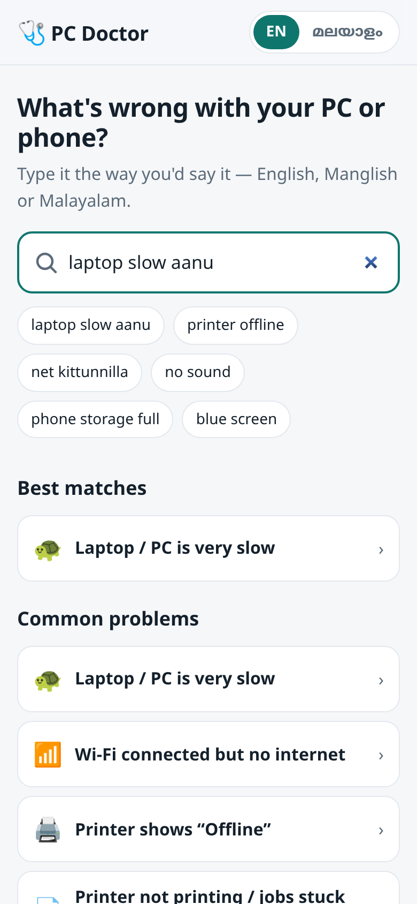
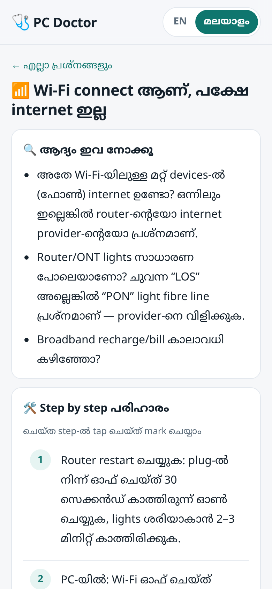
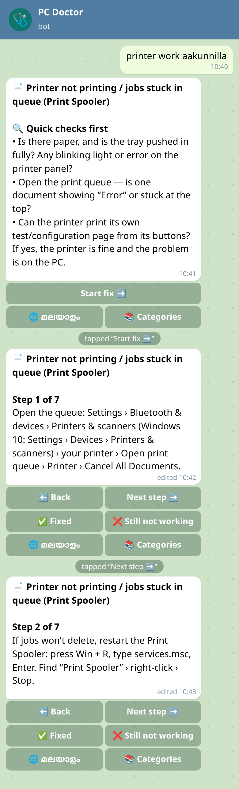
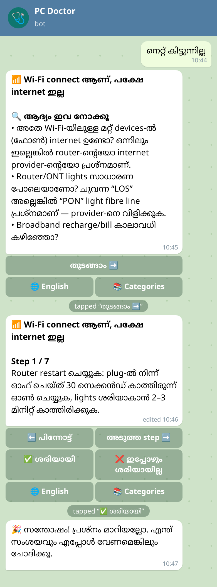

# 🩺 PC Doctor

**Step-by-step fixes for everyday computer, printer, Wi-Fi and phone problems — in English and Malayalam.**
Type the problem the way you would say it (`laptop slow aanu`, `printer work aakunnilla`, `നെറ്റ് കിട്ടുന്നില്ല`) and get a fix written the way an experienced IT support person explains it.

Available as a **Telegram bot** and a **web app**.

[](https://github.com/connectnived-lab/pc-doctor/actions/workflows/ci.yml)


**Live web app:** https://pc-doctor.sites.tab.bot/

| Web — search in Manglish | Web — guide in Malayalam | Bot — step-by-step | Bot — Malayalam |
|---|---|---|---|
|  |  |  |  |

<sub>Bot screenshots are rendered from the bot's real replies with a mocked Telegram API (`npm run screens:chat`); in Telegram, the step screens replace each other in one message.</sub>

---

## Why

Most IT problems people bring to a help desk are the same few dozen: slow laptop, printer offline, Wi-Fi with no internet, full storage, a forgotten password. Good fixes exist, but they are usually in English, scattered, and written for technicians. PC Doctor puts the fixes a support desk uses every day into plain steps, in the language people actually type in Kerala — including Manglish.

## Features

- **42 guides in 10 categories**, each with quick checks → numbered steps with accurate Windows 10/11 menu paths → when to call a technician → safety notes.
- **Understands English, Manglish and Malayalam.** A synonym table maps words like `net kittunnilla`, `ചൂടാകുന്നു`, `pendrive`, `mouse pad` to the same concepts. Handles Malayalam suffixes (`ലാപ്ടോപ്പിൽ`, `printeril`), both Malayalam chillu encodings, and small typos (`bluetoth`, `printr`).
- **Telegram bot** (zero dependencies, long polling):
  - `/start`, `/help`, `/categories`, `/lang`, `/about`
  - free-text question → best guide, plus other close matches as buttons
  - one step per screen with **Next step ➡️ / ⬅️ Back**, edited in place so the chat stays clean
  - **✅ Fixed / ❌ Still not working** feedback; "still not working" shows technician advice and related guides
  - English / മലയാളം per user, and Malayalam questions are answered in Malayalam automatically
  - deep links: `t.me/<bot>?start=p_printer-offline` opens a guide directly
  - works in groups when mentioned; simple flood protection
- **Web app**: search-as-you-type, categories, tick-off checklist for steps, Malayalam/English toggle, WhatsApp share, works offline after the first visit (service worker), dark mode.
- **Privacy**: the web app sends nothing anywhere. The bot stores only per-user language choice (keyed by a salted hash, never the raw Telegram ID) and anonymous totals (views / fixed / not fixed per guide). Message text is never stored.
- **Optional AI fallback**: if — and only if — `AI_API_KEY` is set, questions the knowledge base can't match get a short AI answer, clearly labelled. Everything works fully without it.

## Problems covered

| Category | Guides |
|---|---|
| ⚡ Speed & startup | Laptop / PC is very slow, PC hangs or freezes, PC / laptop won't turn on (no power), Windows won't start (stuck on logo / automatic repair / restart loop), Blue screen error (BSOD) |
| 🔋 Power, battery & heat | Laptop overheating / loud fan, Laptop battery draining fast, Laptop not charging (“plugged in, not charging”) |
| 🪟 Windows & storage | Windows Update stuck or failing, C: drive full / low disk space, Forgot Windows password or PIN, Wrong date/time on PC |
| 📶 Internet & Wi-Fi | Wi-Fi connected but no internet, Wi-Fi not showing / can't find networks, Internet is slow, LAN / Ethernet cable not working (“Unidentified network”), Website not opening / “This site can't be reached” |
| 🖨️ Printer & scanner | Printer shows “Offline”, Printer not printing / jobs stuck in queue (Print Spooler), Printer paper jam, Faded print, lines, streaks or blank pages, Scanner not working |
| ⌨️ Keyboard, mouse & USB | Keyboard not working / wrong letters, Touchpad not working, Mouse not working, USB / pen drive not detected, Bluetooth not working / can't pair, Webcam / camera not working (Teams, Zoom, Meet) |
| 🖥️ Display & sound | No sound from laptop / PC, Microphone not working (others can't hear me), Projector / second monitor / TV not showing, Screen black, flickering or showing lines |
| 🛡️ Security & scams | Virus, pop-up ads or browser hijacked, Fake tech-support / remote-access (AnyDesk) scam, Email / social media account hacked |
| 📊 Office, email & files | Excel / Word not responding or crashing, Outlook / email not sending or receiving, Recover a deleted or lost file |
| 📱 Phone & WhatsApp | Phone storage full, WhatsApp chat backup / restore / new phone, Phone slow / hanging, Phone not charging / charging slowly |

## Quick start

Requires Node.js 18 or newer. There are no npm dependencies.

```bash
git clone https://github.com/connectnived-lab/pc-doctor.git
cd pc-doctor
npm test                      # run all tests
npm run try "printer offline" # see how the matcher scores a question
npm start                     # web app on http://localhost:8080 (bot starts too if a token is set)
```

### Run the Telegram bot

1. In Telegram, open **@BotFather** → `/newbot` → pick a name and username → copy the token.
2. Start the bot:

```bash
TELEGRAM_BOT_TOKEN=123456:ABC... npm run bot
```

Or put the token in `secrets.json` (git-ignored) next to `package.json`:

```json
{ "TELEGRAM_BOT_TOKEN": "123456:ABC...", "DATA_DIR": "/var/lib/pc-doctor" }
```

`npm start` (server.js) serves the web app **and** runs the bot in one process — handy for a single small server. Only run one copy of the bot per token (Telegram allows one long-polling client).

| Variable | Default | Purpose |
|---|---|---|
| `TELEGRAM_BOT_TOKEN` | — | Bot token from @BotFather |
| `DATA_DIR` | `./.data` | Language prefs + anonymous counters |
| `PORT` | `8080` | Web server port |
| `AI_API_KEY` | empty (off) | Optional AI fallback key |
| `AI_BASE_URL` | `https://api.openai.com/v1` | Any OpenAI-compatible API (Groq, OpenRouter, Ollama…) |
| `AI_MODEL` | `gpt-4o-mini` | Model name for the fallback |
| `AI_DAILY_CAP` | `200` | Max AI answers per day |

### Bot usage

| You send | Bot does |
|---|---|
| `/start` | Welcome + language choice |
| `laptop slow aanu` | Opens the "Laptop / PC is very slow" guide; other close matches as buttons |
| `wifi not working` | Best match plus "Wi-Fi connected but no internet" as an alternative |
| `നെറ്റ് കിട്ടുന്നില്ല` | Same guide, in Malayalam |
| `/categories` | 10 category buttons → guides |
| `/lang ml` or `/malayalam` | Switch to Malayalam (also a 🌐 button on every guide) |
| `/help`, `/about` | Usage, credits |

### Publish the web app

`web/` is a self-contained static site — host it anywhere (GitHub Pages, Netlify, Cloudflare Pages, any web server). On GitHub Pages: Settings → Pages → deploy from branch, folder `/web` (or copy `web/` to a `docs/` folder). Fill in `web/config.js` with your bot username and links to show the "Open in Telegram" button and footer links.

## How it works

```
data/problems.json   knowledge base (guides, English + Malayalam, keyword phrases)
data/synonyms.json   concept → words (English / Manglish / Malayalam)
src/matcher.js       normaliser + concept matcher (runs in Node and in the browser)
src/bot/             Telegram client, handlers, i18n strings, message rendering, store, optional AI
server.js            web app + bot in one process
web/                 static site (matcher + data copied in by scripts/build-web.js)
tests/               node:test suites
```

**Matching.** A question is normalised (lower case, Malayalam chillu forms unified, zero-width joiners removed, Latin and Malayalam split apart), then each word — or 2–3 word phrase — is mapped to a concept: exact match, then longest prefix (so `printeril` → printer, `ചൂടാകുന്നു` → heat), then a small typo allowance. Words ending in *-illa* / *ഇല്ല* also add the concept `not`. Each guide lists keyword phrases made of concepts, e.g. `printer offline`, `wifi connect internet not`. A phrase scores when all its concepts are present; longer phrases score more (n²). A device hint lowers PC guides for phone questions and vice versa. The bot opens the top guide when it is clearly ahead of the next one; otherwise it shows the choices as buttons.

## Add your own fix

1. Add an entry to `data/problems.json`:

```json
{
  "id": "projector-no-sound",
  "category": "display",
  "device": "pc",
  "icon": "🔈",
  "title": { "en": "No sound through projector speakers", "ml": "Projector speaker-ൽ sound ഇല്ല" },
  "keywords": ["projector sound^9", "hdmi sound^9", "projector sound not^12"],
  "quick":  { "en": ["…", "…"], "ml": ["…", "…"] },
  "steps":  { "en": ["…", "…", "…", "…"], "ml": ["…", "…", "…", "…"] },
  "technician": { "en": "…", "ml": "…" },
  "safety": { "en": "", "ml": "" }
}
```

   - `keywords` are phrases of concepts from `data/synonyms.json` (or plain words). Weight defaults to (number of words)²; add `^N` to set it.
   - English and Malayalam must have the same number of steps and quick checks (the tests check this).
   - Write menu paths exactly as Windows shows them, with Windows 10 differences noted.
2. If people describe the problem with new words, add them to `data/synonyms.json` under an existing concept (or a new one).
3. Add 2–3 real-world questions for it to `tests/fixtures-questions.json` — English, Manglish and Malayalam.
4. `npm run try "your question"` to check the score, then `npm run build:web && npm test`.

## Tests

`npm test` runs 48 tests with Node's built-in test runner:

- **Matcher:** all 155 sample questions (26 in Malayalam script, plus Manglish and English) must return the right guide as the **top** result; unrelated questions must match nothing; typo, suffix, chillu and device-hint cases.
- **Knowledge base:** every guide complete in both languages, step counts match, Malayalam text is Malayalam, callback data under Telegram's 64-byte limit, no unknown keyword concepts.
- **Bot handlers** with a mocked Telegram API: commands, deep links, paging, feedback counted once, language per user, Malayalam auto-detection, groups, flood limit, AI fallback on/off, and a check that the store never writes raw user IDs or message text.
- **Long polling and app wiring** against a local fake Telegram HTTP server (getMe, command registration, offsets, no duplicates, 401 stop, counters saved to disk).
- **Web:** the static bundle is in sync with the sources and works without Node; `server.js` serves the site and `/health`.

CI runs the suite on Node 18, 20 and 22.

## Limitations

- The guides are general advice. Office PCs often have IT policies (managed updates, fixed IPs, domain passwords) — the guides point to the IT team where that matters.
- Matching is keyword-based, not true language understanding. Unusual phrasing can miss; the bot then offers categories (or the AI fallback, if configured).
- The Malayalam text keeps Windows menu names in English, exactly as they appear on screen. Corrections and better wording from Malayalam speakers are welcome (open an issue or PR).
- Menu paths are for current Windows 10/11 builds; Microsoft occasionally moves settings (e.g. troubleshooters moving to the Get Help app).
- Feedback counts are kept in a local JSON file — fine for one small server, not for many instances.

## Roadmap

- More guides from real help-desk tickets (MS Teams, Tally, CCTV/DVR, UPS, Wi-Fi printers on Android)
- Show the most-reported "still not working" guides on a small stats page so they can be improved first
- Images/GIFs for the trickiest steps
- Hindi and Tamil

## Author

**Nived NS** — IT Support Executive, Kerala
LinkedIn: https://www.linkedin.com/in/YOUR-LINKEDIN · GitHub: https://github.com/connectnived-lab

## License

[MIT](LICENSE) © 2026 Nived NS
